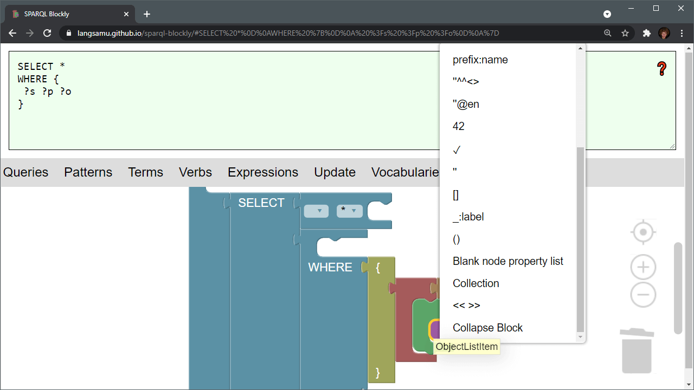

# SPARQL Blockly

[](https://github.com/langsamu/sparql-blockly/actions)

SPARQL Blockly is a library for visualising and building SPARQL.

## Usage
- **[Try it online](https://langsamu.github.io/sparql-blockly/)**
- See the [examples](../examples)

The npm package is ESM only and needs Node.js 22.12 or later. In the browser, load `sparql-blockly.min.js`, which defines `window.SparqlBlockly`.

```js
import * as Blockly from "blockly"
import { sparqlToBlockly } from "sparql-blockly"

const state = sparqlToBlockly("SELECT * WHERE { ?s ?p ?o }")
Blockly.serialization.workspaces.load(state, workspace)
```

Since 5.0.0, `sparqlToBlockly` returns a Blockly workspace state (JSON), or `undefined` when the SPARQL produces no block. It no longer returns an XML element: replace `Blockly.Xml.domToWorkspace(xml, workspace)` with `Blockly.serialization.workspaces.load(state, workspace)`.

## Features

SPARQL Blockly implements the [SPARQL](https://www.w3.org/TR/sparql11-query/) grammar in [Blockly](https://developers.google.com/blockly).

It supports SPARQL 1.1 Query, Update and SPARQL*.



It enables several ways of visual interaction with SPARQL:
- Dragging blocks from a toolbox unto a canvas to assemble valid queries.
- Adding clauses and patterns to query blocks using a context menu.
- Parsing SPARQL query text into blocks.
- Collapsing/expanding parts of a query assemblage.
- Sharing URLs of visual representations.

SPARQL is parsed using [Traqula](https://github.com/comunica/traqula).
